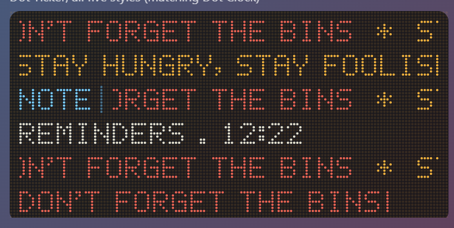

# Dot Ticker

Your own dot-matrix scrolling message board for Windows and macOS, for quotes, reminders or "DON'T FORGET THE BINS".

## What it does

**Five styles.** Tick any or all of them, and put them in any order. Each one becomes a line on the widget.

| Style | What it does |
|---|---|
| Classic scroll | Every message in one continuous ribbon |
| Flip board | One message at a time: it holds, then slides up to the next |
| Tagged | A fixed tag such as `NOTE` on the left, with messages scrolling past it |
| Two-line board | A title line on top (e.g. `REMINDERS · {TIME}`), with messages scrolling underneath |
| Typewriter | Letters appear one by one, with a blinking cursor |

**Your messages.** Add as many as you like, up to 50. Each one can have:
- its own colour
- **Flash**, to mark it urgent
- a **schedule**, so it only shows on certain days and/or between two times (e.g. `STAND-UP` on weekdays 08:00–09:30). Overnight windows work too.
- a **chime** that plays when its schedule starts it, using the same ten 8/16-bit chimes as the other apps

**Codes that fill themselves in:**
- `{TIME}`
- `{DATE}`
- `{DAY}`
- `{UNTIL 25 DEC}`, which shows e.g. `64 DAYS`

**Motion.** You can set:
- the scroll speed
- the direction (right to left, or left to right)
- how long the flip board and typewriter hold each message
- the separator between messages
- pausing while the mouse is over the widget

**Fits with Dot Clock.** It matches Dot Clock's width, dot size and colours. Long messages pan across in the flip board, and the typewriter shifts along so its cursor stays in view.

## How it works

- **Built like the others.** It uses [Tauri](https://tauri.app) and the same shared dot-matrix renderer and chimes. It redraws about 30 times a second while it's on screen.
- **Offline.** It never connects to the internet, and messages are saved to a small file on your computer.

## Building it yourself

See [BUILDING.md](BUILDING.md). The installer is called `Dot Ticker_1.1.0_x64_en-US.msi`.

